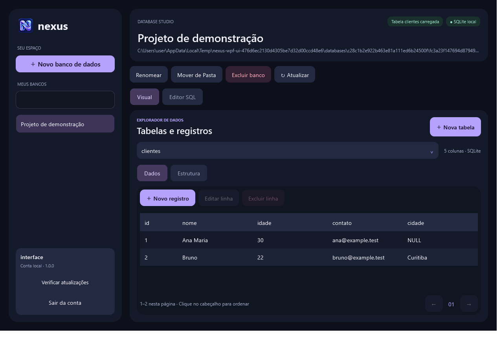

# Nexus

Aplicativo nativo para Windows que reúne bancos SQLite locais em um espaço de trabalho com editor SQL e ferramentas visuais.

**[Instalar Nexus](https://github.com/WillianBN-Dis/Nexus/releases/latest/download/Nexus-Setup.exe)** · [Todas as versões](https://github.com/WillianBN-Dis/Nexus/releases) · [Histórico](CHANGELOG.md)



## Instalação

Execute **Nexus-Setup.exe**. O instalador está em português e permite escolher se deseja criar um atalho na área de trabalho. Windows x64; o runtime .NET está incluído, sem instalação de Python ou SDK.

Se você usa uma prévia 0.6.0, execute o instalador atual uma vez. Contas e bancos existentes são preservados.

## Recursos

- Cadastro e login local por usuário.
- Criar, renomear, mover de pasta/disco e excluir bancos para a Lixeira.
- Criar tabelas e colunas por botões; adicionar, editar, excluir e ordenar registros.
- Editor SQL com resultado em tabela ou texto, limite de 1.000 linhas e prazo de cinco segundos.
- Paginação, chaves compostas, NULL, valores padrão e BLOB.
- Interface WPF escura e adaptável, com operações de banco fora da thread da interface.
- Atualizações automáticas pelo GitHub Releases, com download em segundo plano e instalação na próxima abertura.
- API HTTP de rede local com chaves por banco, permissões de leitura/escrita e consultas paginadas.
- Funcionamento pela bandeja ao fechar a janela e início opcional em segundo plano com o Windows.

O Nexus verifica atualizações ao abrir e a cada seis horas enquanto está aberto. Também é possível usar **Verificar atualizações** e **Reiniciar e atualizar**.

## API e segundo plano

Entre na conta e abra **API e rede** para selecionar IP/porta, bancos e permissões e gerar uma chave. A API começa desligada. Leia o [guia da API](API.md) para autenticação, endpoints, Firewall e exemplos. HTTP é destinado à rede local confiável.

Fechar ou minimizar a janela mantém o Nexus na bandeja. Use **Encerrar Nexus e API** no menu do ícone para sair completamente. O PC deve permanecer ligado e o usuário do Windows conectado.

## Dados

Contas e catálogo ficam em `%LOCALAPPDATA%/Nexus`. Bancos podem ficar em outras pastas, conforme o caminho salvo no catálogo. Senhas usam scrypt com salt; arquivos SQLite não são criptografados. O login é local e não cria uma conta online.

A versão 1.0 trabalha com SQLite local. Não inclui sincronização, recuperação de senha, MySQL ou PostgreSQL. Mantenha backups dos bancos; antes de mover um arquivo, feche outros programas que o utilizam. O instalador ainda não possui assinatura digital.

## Desenvolvimento e publicação

A implementação ativa fica em [native/](native/README.md), em C#/.NET 10/WPF. Para compilar e validar com SDK .NET 10 e Inno Setup 6:

```powershell
./native/build.ps1 -Version 1.1.0
```

Veja [como lançar atualizações](UPDATES.md). Publicar uma tag estável, como `v1.0.1`, executa os testes e gera automaticamente a release com o instalador e os pacotes que os aplicativos usam para atualizar.

O código Python original permanece preservado na raiz; a [documentação legada](docs/LEGACY-PYTHON.md) registra as versões anteriores.
